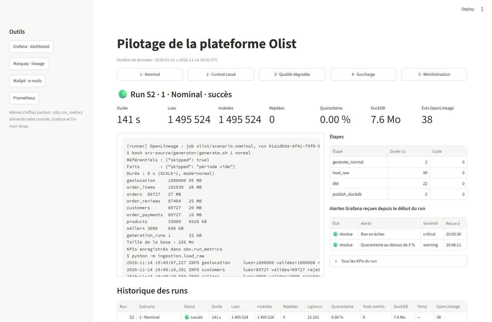

# Olist Data Platform

Plateforme de données locale et observable, orchestrée avec Docker Compose. Elle simule un fournisseur
e-commerce, ingère ses données dans PostgreSQL, les transforme avec dbt et publie un data mart DuckDB.



## Prérequis

- [Docker Desktop](https://docs.docker.com/desktop/setup/install/windows-install/) avec
  [l’intégration WSL 2](https://docs.docker.com/desktop/features/wsl/) activée sous Windows, ou Docker
  Engine avec Docker Compose v2.
- Git, Bash et GNU Make.
- Python 3.12 et [uv](https://docs.astral.sh/uv/getting-started/installation/) : `make migrate` exécute
  les migrations sur l’hôte. `uv` peut installer Python 3.12 avec `uv python install 3.12`.

Sous Windows, lance les commandes depuis un terminal WSL 2 et clone le dépôt dans le système de fichiers
Linux (par exemple `~/projects`), pas sous `/mnt/c`.

Sur Ubuntu/WSL, installe les outils hôte avec :

```bash
sudo apt update
sudo apt install -y git make curl
curl -LsSf https://astral.sh/uv/install.sh | sh
uv python install 3.12
```

## Installation et démarrage

Clone le dépôt, crée le fichier de configuration local et remplace les mots de passe d’exemple :

```bash
git clone https://github.com/fkdia23/olist-data-platform.git
cd olist-data-platform
cp .env.example .env
```

Édite `.env` et remplace les valeurs `change_me_*` par des mots de passe locaux. Si tu modifies un mot
de passe également présent dans une URL de connexion, mets les deux valeurs à jour. Garde ce fichier
privé : il ne doit pas être ajouté au dépôt. Laisse `COMPOSE_PROFILES=core` ; les commandes ci-dessous
activent les autres profils au besoin.

Démarre l’application complète dans cet ordre :

```bash
make up            # PostgreSQL 13 (source), PostgreSQL 16 (entrepôt) et API source
make migrate       # crée les schémas raw et obs
make lineage-up    # démarre Marquez et son interface
make obs-up        # démarre Prometheus, Grafana, cAdvisor, exporters et Mailpit
make pilotage-up   # construit et démarre le runner et Streamlit
```

La première construction des images peut prendre quelques minutes. Vérifie que les services sont prêts :

```bash
make ps
```

Ouvre ensuite [Streamlit](http://localhost:8501). Pour créer les données de démonstration et exécuter
le premier pipeline, lance **5 · Réinitialisation**, puis **1 · Nominal**.

## Interfaces

| Service | Adresse locale |
|---|---|
| Streamlit — console de pilotage | [http://localhost:8501](http://localhost:8501) |
| Grafana — tableaux de bord et alertes | [http://localhost:3001](http://localhost:3001) |
| Prometheus — métriques | [http://localhost:9090](http://localhost:9090) |
| Marquez — lignage des données | [http://localhost:3000](http://localhost:3000) |
| Mailpit — e-mails de test | [http://localhost:8025](http://localhost:8025) |
| API du fournisseur simulé | [http://localhost:8000](http://localhost:8000) |

PostgreSQL est aussi publié sur `localhost:5433` (source) et `localhost:5432` (entrepôt). cAdvisor
est accessible sur [http://localhost:8080](http://localhost:8080).
Pour Grafana, connecte-toi avec l’utilisateur `admin` et le mot de passe défini par
`GRAFANA_ADMIN_PASSWORD` dans `.env`.

## Arrêt, redémarrage et développement

- `make down` arrête les conteneurs, mais conserve les volumes et les données.
- `make up`, puis les quatre commandes de profils ci-dessus, redémarre la plateforme.
- Le bouton **5 · Réinitialisation** remet à blanc les données de démonstration via l’application.
- `make test` lance les tests unitaires ; `make check` lance le lint et les tests.
- Pour développer Streamlit avec rechargement à chaud, arrête son conteneur avec
  `docker compose stop streamlit`, puis lance `uv run --env-file .env streamlit run streamlit/app.py`.

La suppression des volumes Docker efface les bases et les données persistantes. Ne lance pas
`docker compose --profile '*' down -v` sauf si tu veux vraiment les supprimer.

## Architecture et scénarios

Pour la description détaillée des services, du parcours des données, des alertes, des métriques et des
scénarios de démonstration, consulte le [README Architecture et systèmes](docs/README.md).
