# Olist Data Platform — Architecture et systèmes

Une plateforme de données complète, observable de bout en bout, qui tourne sur un poste avec Docker.

Un fournisseur simulé (PostgreSQL 13 + API) livre des commandes e-commerce de type Olist. La plateforme
les ingère sous contrat, les transforme avec dbt, publie un data mart DuckDB, et rend chaque exécution
visible partout : console de pilotage **Streamlit**, métriques **Prometheus**, tableaux de bord et alertes
**Grafana**, e-mails **Mailpit**, traçabilité **OpenLineage / Marquez**, exécutions planifiées par **crons**.

Le projet se présente en jouant cinq scénarios, du jour normal à l'incident. Chacun laisse une trace
différente dans chaque outil. Ce document décrit les systèmes et sert aussi de déroulé de démonstration.

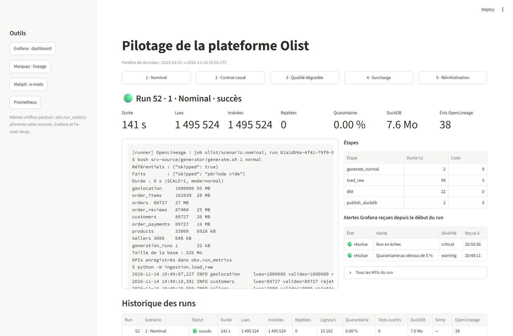

---

## Sommaire

1. [Ce que montre la démo](#1-ce-que-montre-la-démo)
2. [Architecture](#2-architecture)
3. [Démarrer la plateforme](#3-démarrer-la-plateforme)
4. [Déroulé de la présentation](#4-déroulé-de-la-présentation-environ-15-minutes)
5. [Volumétrie mesurée](#5-volumétrie-mesurée)
6. [Sous le capot](#6-sous-le-capot)
7. [Structure du dépôt](#7-structure-du-dépôt)
8. [Limites connues et pistes](#8-limites-connues-et-pistes)

---

## 1. Ce que montre la démo

| Outil | Rôle dans la plateforme | Adresse |
|---|---|---|
| **Streamlit** | Lancer un scénario, suivre le run en direct (étapes, logs, KPIs, alertes), gérer les crons | http://localhost:8501 |
| **Grafana** | Dashboard *Olist · Pilotage* (runs, volumétrie, qualité, infrastructure, crons) et 5 règles d'alerte | http://localhost:3001 |
| **Prometheus** | Collecte les métriques du runner, de l'API, des deux PostgreSQL et des conteneurs | http://localhost:9090 |
| **Marquez** | Graphe OpenLineage : de la table source jusqu'au fichier DuckDB, run par run | http://localhost:3000 |
| **Mailpit** | Boîte mail de test : récapitulatif de chaque run et alertes Grafana | http://localhost:8025 |
| **cAdvisor** | CPU, mémoire, disque de chaque conteneur | http://localhost:8080 |

Les cinq scénarios, un bouton chacun dans Streamlit :

| Scénario | Ce qui se passe | Ce qu'on doit voir |
|---|---|---|
| **1 · Nominal** | Génération normale → ingestion → `dbt build` → publication DuckDB | Run vert, 7 modèles et 16 tests dbt OK, data mart publié, lignage complet |
| **2 · Contrat cassé** | 50 dates illisibles + 50 clients orphelins chez le fournisseur | 100 lignes rejetées, run en échec, alertes « Run en échec » et « Lignes rejetées » |
| **3 · Qualité dégradée** | +8 % d'articles conformes au contrat mais faux pour le métier (prix nul, frais négatifs) | Run vert mais 7,4 % de quarantaine, 2 tests dbt en avertissement, alerte « Quarantaine > 5 % » |
| **4 · Surcharge** | 30 jours rejoués à 40 fois le volume, puis une requête lourde sur l'entrepôt | ~750 000 lignes ingérées, pic CPU de pg16, plus de 700 Mo de fichiers temporaires, alerte « Débordement disque » |
| **5 · Réinitialisation** | Entrepôt, data mart et source remis à blanc, puis source propre régénérée | Plateforme prête pour une nouvelle démonstration |

---

## 2. Architecture

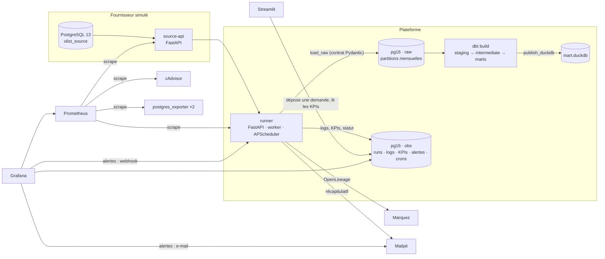

**Le parcours d'un run**

1. Un clic dans Streamlit (ou un cron) insère une ligne `queued` dans `obs.pipeline_runs`. Streamlit n'exécute rien.
2. Le worker du runner réserve la plus ancienne demande (`FOR UPDATE SKIP LOCKED` : une demande n'est prise qu'une fois).
3. Il lance les étapes du scénario dans l'ordre et s'arrête au premier échec. Chaque ligne de sortie va dans `obs.run_logs`, que la console Streamlit affiche toutes les 2 secondes.
4. Chaque outil écrit ses KPIs dans `obs.run_metrics` grâce à la variable `RUN_ID`. Le runner y ajoute les durées d'étape, le bilan dbt, le taux de quarantaine et le nombre d'événements OpenLineage.
5. Le runner émet un run OpenLineage par scénario et un run enfant par étape. dbt-ol s'y rattache avec `OPENLINEAGE_PARENT_ID`.
6. Prometheus lit `/metrics` du runner. Grafana évalue ses règles toutes les 20 s et notifie Mailpit (e-mail) et le runner (webhook → `obs.alerts`).
7. En fin de run, le runner envoie un récapitulatif à Mailpit. **Les mêmes chiffres** apparaissent dans Streamlit, Grafana et l'e-mail, car tous les trois lisent `obs.run_metrics`.

---

## 3. Démarrer la plateforme

Le guide d’installation et de démarrage complet se trouve dans le [README principal](../README.md#installation-et-démarrage).
Il couvre les prérequis, la configuration, le lancement des profils Docker et l’accès aux interfaces.

| Profil Compose | Services | Quand le lancer |
|---|---|---|
| `core` | pg13, pg16, source-api | toujours (`make up`) |
| `lineage` | marquez, marquez-web | pour la traçabilité (`make lineage-up`) |
| `observability` | prometheus, cadvisor, 2 exporters, grafana, mailpit | pour la supervision (`make obs-up`) |
| `pilotage` | runner, streamlit, mailpit | pour jouer les scénarios (`make pilotage-up`) |

---

## 4. Déroulé de la présentation (environ 15 minutes)

Ouvre cinq onglets avant de commencer : Streamlit, Grafana (dashboard *Olist · Pilotage*), Marquez,
Mailpit, Prometheus. Pars d'une plateforme propre : **5 · Réinitialisation** puis **1 · Nominal**.

### Scénario 1 · Nominal : la journée type (3 min)

**Clic** : `1 · Nominal` dans Streamlit.

**À montrer dans Streamlit** : les quatre étapes défilent dans la console (`generate_normal`, `load_raw`,
`dbt`, `publish_duckdb`). Les KPIs se remplissent en direct : lignes lues, insérées, rejetées, quarantaine,
taille du data mart, événements OpenLineage.


**À dire** : *« Streamlit ne fait que déposer une demande en base. Le runner l'exécute ; si je ferme
l'onglet, le run continue. L'ingestion valide chaque ligne avec un contrat Pydantic, et elle est
idempotente : relancer ne crée aucun doublon. »*

**Le récapitulatif dans Mailpit** : un e-mail par run, avec les étapes, la volumétrie table par table,
le bilan dbt et la taille du data mart.

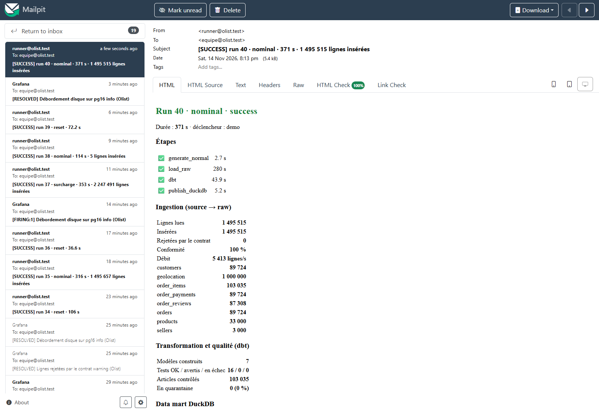

**La traçabilité dans Marquez** : ouvre le dataset `mart.main.fct_order_items` (namespace `duckdb`).
Le graphe remonte jusqu'aux tables du fournisseur : source PostgreSQL 13 → `raw` → `staging` →
`intermediate` → `marts` → fichier DuckDB. Chaque job enfant porte le nom de son scénario
(`scenario.nominal.load_raw`, `scenario.nominal.dbt-run-olist`…).

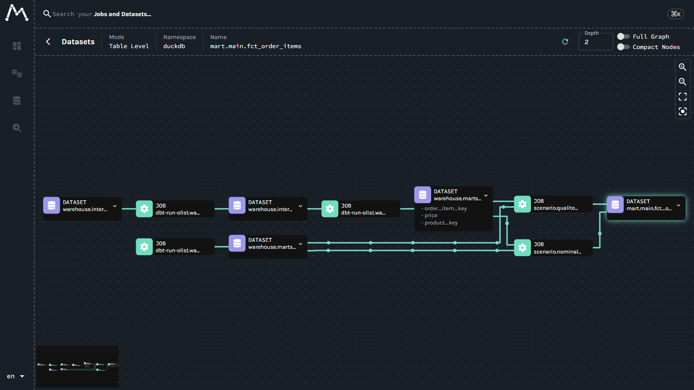

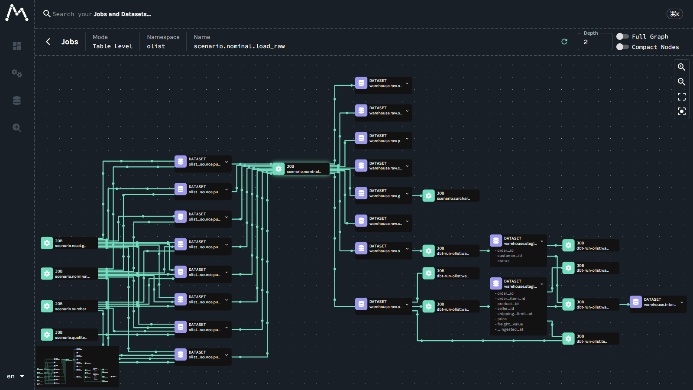

**À dire** : *« Les datasets portent exactement les mêmes noms côté runner et côté dbt. Marquez
raccorde donc les graphes tout seul, et chaque événement d'ingestion transporte le nombre de lignes
écrites. »*

### Scénario 3 · Qualité dégradée : le piège silencieux (3 min)

Ce scénario passe avant le contrat cassé : c'est le plus subtil.

**Clic** : `3 · Qualité dégradée`.

Le fournisseur ajoute 8 % d'articles **valides pour le contrat** (bons types, bons formats, références
existantes) mais **faux pour le métier** : prix à 0, frais de port négatifs. L'ingestion les accepte,
c'est voulu : le contrat contrôle la structure, dbt contrôle le métier.

**À montrer** : run **vert**, mais quarantaine à **7,41 %** et deux tests dbt en avertissement.
Environ une minute plus tard, l'alerte Grafana « Quarantaine au-dessus de 5 % » arrive dans le panneau
des alertes de Streamlit (webhook) et dans Mailpit (e-mail).

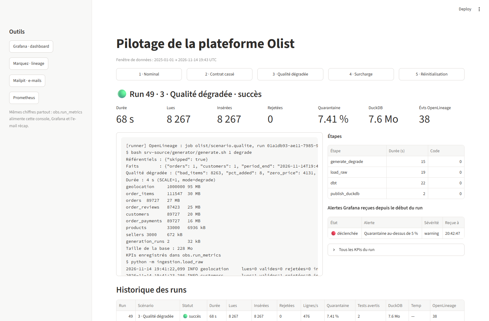

**À dire** : *« Un run qui réussit n'est pas un run sain. Les lignes fausses sont écartées dans
`intermediate.int_order_items__quarantine` : elles n'atteignent jamais le data mart, et un test
`severity: error` sur `fct_order_items` le garantit. »*

### Scénario 2 · Contrat cassé : l'incident franc (2 min)

**Clic** : `2 · Contrat cassé`.

Le fournisseur livre 50 commandes à la date illisible (`14/11/2026 18h37`) et 50 commandes dont le
client n'existe pas. L'ingestion les rejette toutes et les archive dans `raw.rejects`, avec la raison
et la ligne brute. L'option `--fail-on-reject` fait échouer le run.

**À montrer** : run **rouge**, 100 lignes lues et 100 rejetées, le message d'erreur, puis les alertes
« Run en échec » (critique) et « Lignes rejetées par le contrat ».

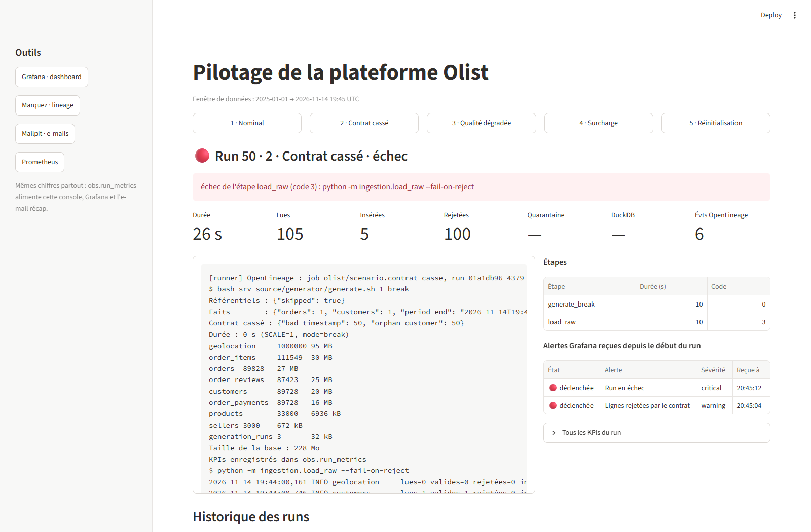

**Dans Mailpit** : le récapitulatif `[FAILED]` et les alertes Grafana `[FIRING]`. Cinq minutes plus tard,
les mêmes alertes repassent en `[RESOLVED]`.

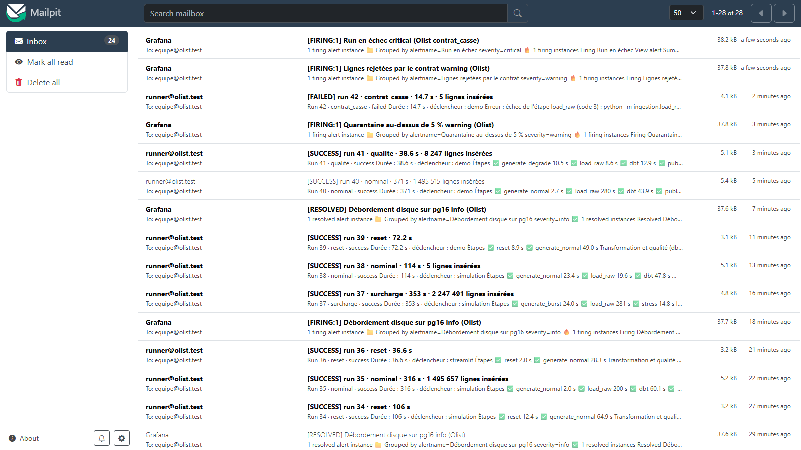

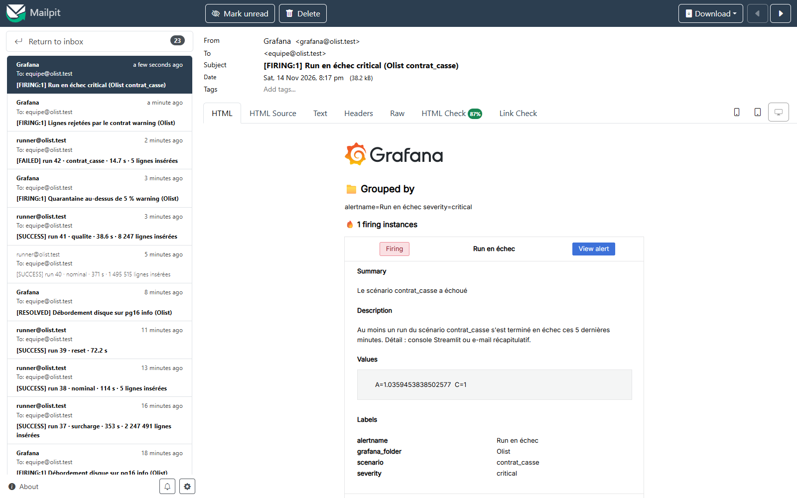

### Scénario 4 · Surcharge : la plateforme sous tension (3 min)

**Clic** : `4 · Surcharge`.

Le fournisseur rejoue les 30 derniers jours à 40 fois le volume normal (~750 000 lignes d'un coup),
puis le runner lance une auto-jointure de `raw.geolocation` sur 4 connexions (~90 millions de paires),
avec un `work_mem` volontairement petit : les hachages débordent sur disque.

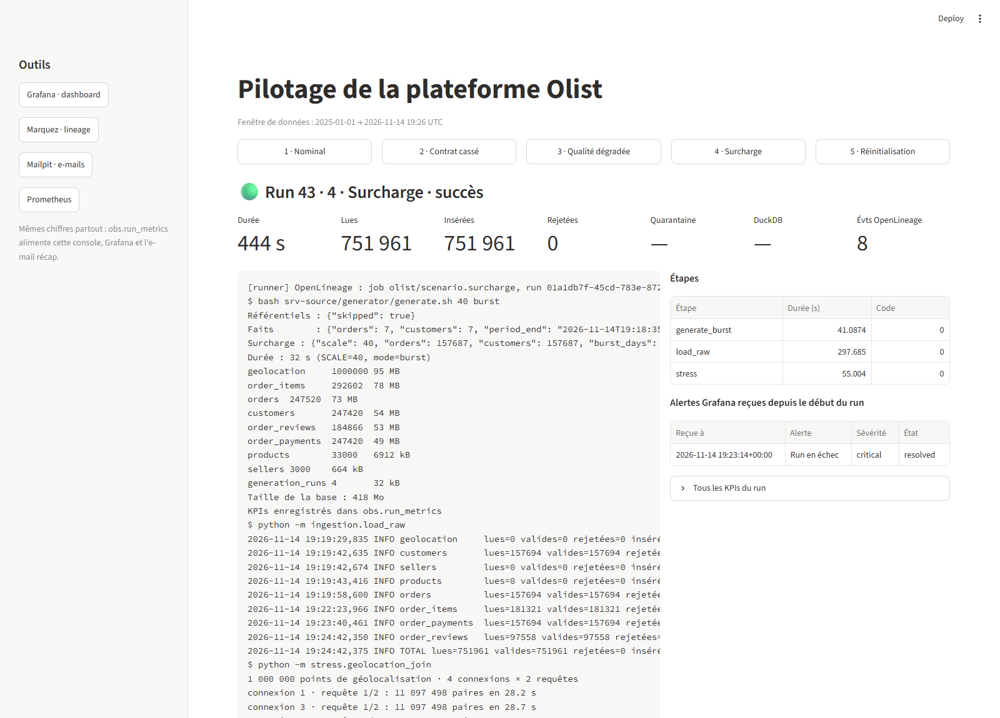

**Dans Prometheus**, le CPU par conteneur montre pg13 (génération), puis pg16 et le runner (ingestion),
puis le pic de pg16 pendant la requête lourde : environ 7 cœurs dans la démonstration enregistrée
(4 connexions, chacune aidée par des workers parallèles de PostgreSQL).

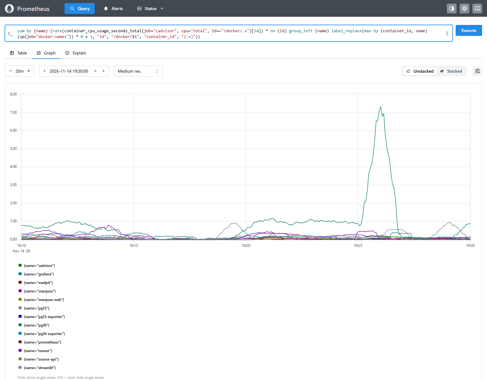

**À dire** : *« Sous Docker Desktop, cAdvisor ne connaît les conteneurs que par leur identifiant.
Prometheus interroge donc aussi l'API Docker (job `docker-names`) pour la table identifiant → nom de
service, et Grafana fait la jointure. »*

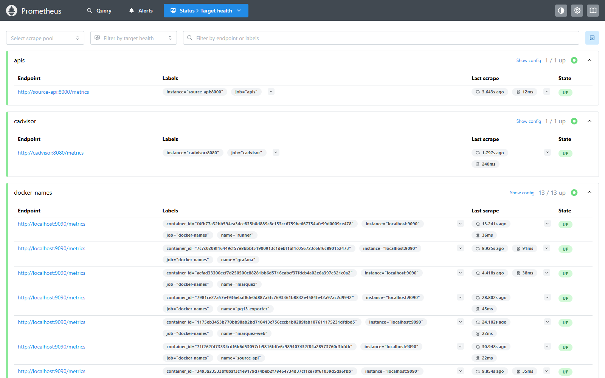

### Crons : l'exploitation planifiée (2 min)

Dans la section **Crons** de Streamlit, ajoute `nominal-2min`, expression `*/2 * * * *`, scénario
*Nominal*. Le runner relit `obs.schedules` toutes les 30 s : le cron part **sans redémarrage**, et ses
runs apparaissent avec le déclencheur `cron`.

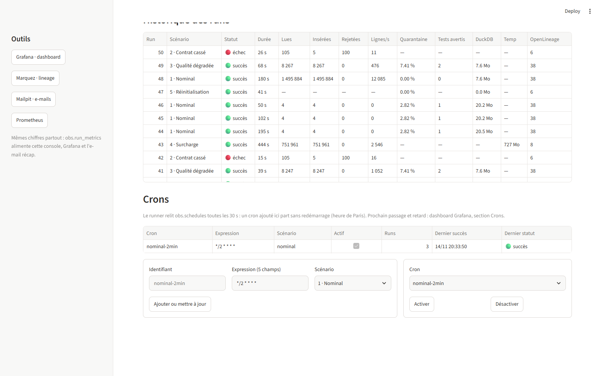

**À dire** : *« Le planificateur ne fait que déposer des demandes dans la même file que les boutons.
Il publie ses propres métriques : prochain passage, dernier succès, intervalle prévu. Si un cron ne
réussit plus depuis deux intervalles, l'alerte "Cron en retard" part. »*

Ce qui s'est passé pendant la démonstration enregistrée, et qui illustre bien la règle :

| Heure | Événement |
|---|---|
| 20:26:37 | Cron `nominal-2min` créé (`*/2 * * * *`) |
| 20:28:02 | 1re demande ; ce run dure 196 s, plus que l'intervalle |
| 20:30:02 | 2e demande, en attente derrière la 1re |
| 20:31:19 | 1er succès, plus de 4 minutes après la création |
| 20:31:44 | Alerte **« Cron en retard »** déclenchée : e-mail dans Mailpit, ligne dans `obs.alerts` |
| 20:37:08 | Alerte résolue : les passages suivants réussissent dans les temps |

Un cron dont le travail dure plus longtemps que son intervalle prend du retard. Pour un cron régulier
sans alerte, prends `*/5 * * * *`. Pour une alerte garantie, crée un cron sur *Contrat cassé* : il
échoue à chaque passage.

Pense à désactiver les crons de démonstration à la fin (bouton **Désactiver**).

### Retour au vert : Réinitialisation puis Nominal (2 min)

**Clics** : `5 · Réinitialisation`, puis `1 · Nominal`. Les alertes repassent en *résolue*, la quarantaine
retombe à 0 %, le data mart est republié. L'historique garde la trace de toute la démonstration.

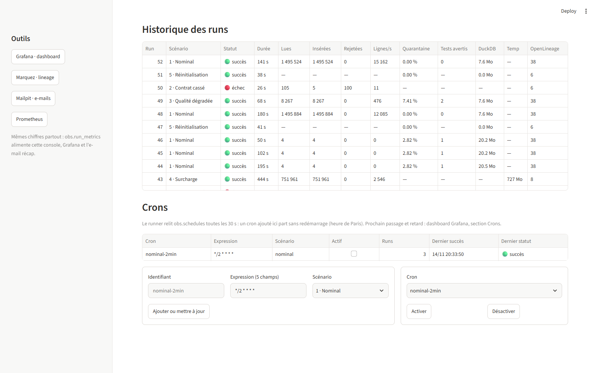

### Grafana : le dashboard « Olist · Pilotage »

Le dashboard est provisionné depuis `observability/grafana/dashboards/olist-pilotage.json` et sert de
page d'accueil. Il se rafraîchit toutes les 10 secondes, en cinq sections :

| Section | Ce qu'elle montre | Source |
|---|---|---|
| Vue d'ensemble | Runs par statut, quarantaine, rejets, lignes insérées, taille DuckDB, événements OpenLineage ; table des 30 derniers runs avec leur volumétrie | `obs` (PostgreSQL) |
| Volumétrie | Lignes lues / insérées / rejetées par run (échelle log), durée des étapes, commandes par mois (partitions), taille des tables, quarantaine par build, insertions par seconde, taille des bases | `obs` + postgres_exporter |
| Infrastructure | CPU et mémoire par conteneur, fichiers temporaires, connexions, requêtes et latence p95 de l'API | cAdvisor, postgres_exporter, API |
| Crons | Crons définis et leur dernier statut, prochain passage, temps depuis le dernier succès, exécutions par statut | `obs` + métriques `cron_*` |
| Alertes et traçabilité | État des 5 règles, alertes reçues par le runner, liens vers Marquez, Streamlit, Mailpit | Grafana + `obs.alerts` |

<!-- Captures Grafana à ajouter : docs/images/13-grafana-vue-ensemble.png, 14-grafana-volumetrie.png,
     15-grafana-infrastructure.png, 16-grafana-alertes.png -->

---

## 5. Volumétrie mesurée

Chiffres relevés pendant une simulation complète, sur un poste Windows 11 avec Docker Desktop (WSL 2).

| Scénario | Durée | Lignes ingérées | Rejets | Qualité | Autres mesures |
|---|---|---|---|---|---|
| Réinitialisation | 30 à 40 s | — | — | — | Source régénérée : 1 000 000 géolocalisations, 89 721 commandes, 103 303 articles (226 Mo) |
| Nominal, chargement complet | 2 à 3 min | 1 495 834 | 0 | 0 % de quarantaine, 16 tests OK | 12 700 à 19 400 lignes/s ; DuckDB 7,6 Mo |
| Qualité dégradée | ~40 s | 8 269 | 0 | **7,41 %** (8 265 articles), 2 tests avertis | Alerte reçue ~60 s après la fin du run |
| Contrat cassé | ~12 s | 0 | **100** | — | Run en échec (code 3), 2 alertes |
| Surcharge | 2,5 à 7,5 min | ~752 000 | 0 | — | 2 500 à 8 800 lignes/s ; requête lourde : 88,8 M de paires, 727 Mo temporaires, pg16 de 3 à 7 cœurs |

Les durées varient du simple au double d'une exécution à l'autre : le poste fait tourner les 13
conteneurs en même temps, et l'ingestion passe par l'API (pagination) puis par PostgreSQL.

Délai d'une alerte : 20 s d'évaluation + 30 s de regroupement, soit environ une minute après la fin du
run. Résolution : environ 5 minutes après le retour à la normale.

**Cohérence du data mart** vérifiée après *Réinitialisation → Surcharge → Nominal* : 284 337 articles
dans `raw.order_items`, 284 337 valides, 284 337 dans `marts.fct_order_items` et dans DuckDB, aucune
ligne orpheline.

---

## 6. Sous le capot

### Les règles d'alerte

Définies dans `observability/grafana/provisioning/alerting/rules.yaml`, toutes envoyées au point de
contact `olist-alertes` : e-mail vers Mailpit **et** webhook vers le runner (`obs.alerts`).

| Règle | Requête Prometheus | Seuil | Scénario qui la déclenche |
|---|---|---|---|
| Run en échec (critique) | `increase(runner_runs_total{status="failed"}[5m])` | > 0 | Contrat cassé |
| Lignes rejetées par le contrat | `increase(pipeline_rows_total{kind="rejected"}[10m])` | > 0 | Contrat cassé |
| Quarantaine au-dessus de 5 % | `pipeline_quarantine_ratio * 100` | > 5 | Qualité dégradée |
| Débordement disque sur pg16 | `increase(pg_stat_database_temp_bytes{datname="warehouse"}[5m])` | > 400 Mo | Surcharge |
| Cron en retard | `time() - cron_last_success - 2 × intervalle` | > 0 | Cron qui échoue en boucle |

Les compteurs du runner sont créés à zéro dès son démarrage : sans cela, `increase()` ne verrait pas
le premier échec.

### Les métriques du runner (`runner:8000/metrics`)

| Métrique | Contenu |
|---|---|
| `runner_runs_total{scenario,status}` | Runs terminés |
| `runner_run_duration_seconds` | Histogramme des durées |
| `runner_step_duration_seconds{scenario,step}` | Durée de la dernière exécution de chaque étape |
| `pipeline_rows_total{kind}` | Lignes lues, insérées, rejetées par l'ingestion |
| `pipeline_quarantine_ratio` | Part des articles en quarantaine au dernier build dbt |
| `mart_duckdb_size_bytes` | Taille du data mart publié |
| `lineage_events_total{emitter}` | Événements OpenLineage émis (runner, dbt) |
| `cron_*` | Prochain passage, dernier succès, intervalle prévu, exécutions par statut |

### OpenLineage

```
olist/scenario.nominal                         run parent (START → COMPLETE ou FAIL)
├── scenario.nominal.generate_normal           décrit par le runner : sorties = tables de la source
├── scenario.nominal.load_raw                  source → raw, avec le nombre de lignes écrites par table
├── scenario.nominal.dbt-run-olist             émis par dbt-ol, rattaché via OPENLINEAGE_PARENT_ID
└── scenario.nominal.publish_duckdb            marts → mart.duckdb
```

Les datasets suivent la convention de dbt-ol : namespace `postgres://pg16:5432`, nom
`warehouse.raw.orders`. Une panne de Marquez ne fait jamais échouer un run : l'émission est protégée
et le nombre d'événements réellement envoyés est compté dans les KPIs.

### Le data mart incrémental

`marts.fct_order_items` est incrémental sur `_ingested_at`, la date d'arrivée dans `raw`, et non sur la
date d'achat. Un article qui arrive en retard (les 30 jours rejoués par la surcharge, une source
régénérée) est donc bien repris. Une table vide est reconstruite entièrement. La réinitialisation vide
les tables dbt sans les supprimer, ce qui conserve leur structure et leurs droits.

### Les crons

APScheduler tourne dans le runner (heure de Paris). Toutes les 30 s, il aligne ses tâches sur la table
`obs.schedules`, que Streamlit modifie. Un déclenchement ne fait que déposer une demande dans la même
file que les boutons : un seul chemin d'exécution, quel que soit le déclencheur.

---

## 7. Structure du dépôt

```
contracts/           contrats de données Pydantic (structure, formats, valeurs permises)
ingestion/           load_raw (source → raw, idempotent, partitionné), reset, migrations Alembic
dbt/                 staging, intermediate (contrôles et quarantaine), marts, tests
mart/                publish_duckdb : marts PostgreSQL → fichier DuckDB, bascule atomique
stress/              requête lourde du scénario Surcharge
runner/              worker des scénarios, crons, métriques, OpenLineage, récapitulatif e-mail
streamlit/           console de pilotage
srv-source/          fournisseur simulé : schéma, générateur SQL, API FastAPI
observability/       Prometheus (cibles) et Grafana (sources, dashboard, alertes)
lineage/             configuration de Marquez
scripts/             rôles PostgreSQL (monitor, grafana_ro, streamlit_app), base Marquez, contrôles
docs/images/         captures de ce README
```

---

## 8. Limites connues et pistes

- **`mart-api`** est prévu dans la configuration de Prometheus (en commentaire) mais n'existe pas encore.
- Les fichiers YAML de dbt décrivent des modèles pas encore écrits (`stg_customers`, `dim_products`,
  `fct_orders`…) : dbt affiche des avertissements à chaque build, sans conséquence.
- **cAdvisor sous Docker Desktop** ne nomme pas les conteneurs (stockage d'images containerd) : les
  noms viennent du job Prometheus `docker-names`, qui lit `docker.sock`. Prometheus tourne donc en root.
- Le modèle incrémental suppose qu'aucune ingestion ne tourne pendant `dbt build` : c'est le cas, car le
  runner enchaîne les étapes une par une.
